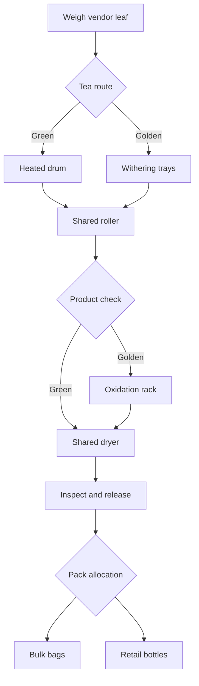

# Dept 1 – Production Engineering

## Current portfolio scope and department responsibilities

The portfolio has 16 standalone projects plus the integrated factory capstone (Project 14), for 17 total. The seasonal operating baseline is near-daily during active months, with roughly 1,000 kg total per active month, variable daily output, golden tea only when eligible leaf is available, and zero fresh-leaf processing in January–February. Winter packing and shipping draw from released stock. Retail uses 50 g and 100 g bottles. DAY-40 is one synthetic integration test (30 kg green, 10 kg golden; 36 kg bulk and 4 kg retail in 40 × 50 g and 20 × 100 g bottles). MONTH-VAR is a separate synthetic month (994 kg over 29 operating days).

Production owns stage inputs and outputs, hopper and scale readings, weights at each handoff, queue exposure before processing, measured discard, recovered material, and estimated moisture removal. Project 15 extends packing with a virtual robot, bottle-size changeover, reachability checks and interrupted pick recovery. Project 17 tests whether revised handoffs and delivery timing reduce spoilage without moving the bottleneck downstream.

## Working block diagram

## Purpose and PanchaRupa history

This department owns the workflow above and signs off on its handoffs. One person may cover several roles. PanchaRupa produced green tea and golden tea, a specialty black tea, from mostly vendor-supplied hand-picked leaves. The founder recalls adding a heated drum for early heat treatment, then automating final drying, then introducing a rolling machine. Monthly output reportedly rose from **100 to 1,000 kg**. Most tea went in bulk bags to the Chattogram auction channel. Some went into plastic retail bottles. Exact historical recipes, machine specifications, costs and intermediate production figures are unknown. This handbook specifies a proposed virtual workflow and a hypothetical low-cost physical configuration.

### How the work moves
Receiving creates a unique vendor lot with gross, tare, net and accepted mass. Assign lots to a product and issue weighed portions. Keep waiting leaf in labeled staging positions and log time from receipt to first operation. Log the product, recipe version, batch ID, issued mass and responsible operator before startup.

Green tea goes through the drum before shared rolling. Golden tea goes through withering before rolling and has an oxidation stage before drying. Both routes reserve the roller and dryer. Each station sends Ready, Accepted, Complete and Fault messages with the active batch ID. If the dryer is busy, queue the batch in a named position and record the delay. Block new transfer when the buffer is full. A product switch requires clearing the station and confirming the next recipe. The operator inspects finished tea, then releases it to bulk or retail packing.

### How the department designs machinery
Specify each machine by batch load, occupied cycle time, labor minutes, energy and cleaning time. Compare a simple locally fabricated frame or chute against a quoted manufactured alternative on repairability and total cost. Keep heat source, materials, settings and safeguards as specification fields. Use the simulated equipment to evaluate options before making any physical procurement decision.

### Engineering outputs and handoffs
Give Controls the station states, transfer logic and instrumentation needs. Give Operations a resource calendar and the batch-size, yield and changeover assumptions. Give Quality sample points and measurable checks. Add equipment history cards with the upgrade order of drum, final dryer and rolling machine. Validate both tea routes and a shared-dryer queue before adding scheduling optimization.

## Machines, tools and investment

| Hypothetical asset or tool | Illustrative BDT | Purpose |
|---|---:|---|
| Intake hopper, bins and short chutes | 30,000 | Weigh receipt, stage tagged batches and transfer by gravity where practical. |
| Green tea heated drum | 65,000 | Rotate and apply early heat treatment. Confirm readiness before passing leaf to rolling. |
| Golden tea trays, fan hardware and racks | 35,000 | Provide separate withering and oxidation positions and track occupancy. |
| Shared roller | 55,000 | Reserve by batch and clear material at product changeover. |
| Shared final dryer | 95,000 | Dry batches by recipe and return completion and fault states. |
| Bulk and retail packing benches and mechanical fixtures | 45,000 | Support filling, sealing or capping and move completed packs to inspection. |
| Installation, change parts and initial mechanical spares | 25,000 | Complete mechanical fit-up and retain critical wear items. |
| **Department startup funding** | **350,000** | Before working capital. |

## How the department gets its budget

Start with the mechanical bottleneck register. Rank equipment by released kg gained per month, downtime avoided, repair support and total installed cost. Approve the drum, dryer and roller as distinct assets. Obtain quotes before real purchase. Allocate asset depreciation and station upkeep by occupied machine time. Charge measured labor directly to the product or pack run where practical. The separate leaf line in the reconciled example assigns BDT 100,000 to materials, equal to BDT 100 per released kg across the example mix.

1. The department lead submits a request with asset or operating item, units, specification, alternatives, reason, required date and cost center.
2. Operations checks utilization, batch forecasts and bottlenecks. The requesting lead estimates released kg gained, time saved, failure exposure reduced or a test requirement met.
3. Finance separates capital, one-time startup costs, recurring production costs, working capital and selling costs. It checks committed spend and projected cash before approval.
4. The founder approves a spending ceiling. For physical purchasing, obtain actual quotes and record landed and installed cost, local support and spare parts. Match approved purchase, receipt and invoice.
5. At month-end, compare budget, committed spend and actuals. Split material differences into quantity, price and timing. Record the corrective owner and revise the next forecast.

## How this department costs the tea

| Department cost pool | BDT/month |
|---|---:|
| Base process labor | 16,000 |
| Process consumables | 4,000 |
| Mechanical upkeep | 6,000 |
| **Recurring factory cash budget** | **26,000** |
| Illustrative depreciation | 5,833.33 |
| **Monthly manufacturing allocation** | **31,833.33** |

This department contributes **BDT 31.83 per released kg** at 1,000 kg/month. Cost driver: Eligible machine minutes by route and metered machine energy where separable. Assign identifiable costs to a specific batch or sales channel first. Allocate the remaining pool by each product’s share of the stated driver. Reconcile direct charges, allocated overhead and period variances to the ledger. Keep the same electricity meter, machine, labor and quality cost with one budget owner.

## Shared factory budget and reconciliation

These numbers are **synthetic BDT planning allowances**, not prices researched in Panchagarh or historical PanchaRupa accounts. The virtual project assumes an existing computer and browser with zero incremental software and equipment spend. The physical example is an exercise in investment and production costing.

| Department | Startup funding (BDT) | Recurring factory cash (BDT/month) |
|---|---:|---:|
| Production Engineering | 350,000 | 26,000 |
| Capacity and Operations | 40,000 | 8,000 |
| Controls and Electrical | 165,000 | 12,000 |
| Quality and Traceability | 55,000 | 6,000 |
| HMI and Simulation | 0 | 0 |
| Testing and Portfolio | 25,000 | 2,000 |
| Business Operations and Planning | 25,000 | 7,000 |
| **Total departmental funding** | **660,000** | **61,000** |

Treat BDT 10,000 of the startup total as one-off commissioning and training. Use BDT 650,000 as the example depreciation base. Straight-line allocation over 60 months with zero residual gives BDT 10,833.33/month. These are modeling choices.

### Design month and direct materials

In the illustrative 1,000 kg costing model, a 25% aggregate net yield implies 4,000 kg of fresh leaf at BDT 25/kg. The 1,000 kg costing case is independent of the variable 994 kg active-month fixture. Apply product-specific yields to live scenario inputs.

Use a 90% bulk / 10% retail split. The bulk example uses 36 bags of 25 kg at BDT 50 per bag. The costing example uses 800 × 50 g bottles at BDT 4 and 600 × 100 g bottles at BDT 8. Confirm pack sizes and commercial requirements before any physical use.

| Worked cost bridge | BDT/month | BDT per released kg |
|---|---:|---:|
| Fresh leaf | 100,000 | 100.00 |
| Bulk bags and retail bottles | 9,800 | 9.80 |
| Departmental recurring factory cash | 61,000 | 61.00 |
| Depreciation | 10,833.33 | 10.83 |
| **Illustrative manufacturing cost** | **181,633.33** | **181.63** |
| Bulk outbound freight, tracked as selling expense | 9,000 | 9.00 plant-wide or 10.00 per bulk kg |

Packaging adds BDT 2 per bulk kg and BDT 80 per retail kg before labor or yield differences. The plant-wide figure is cost per released kg. Recognize cost against sales using opening stock, production, shipped quantities and closing stock. Track broker fees, retail delivery, rent, taxes, site works and finance separately when figures become available. They are outside this simplified cost bridge.

Recurring factory cash in the example is BDT 170,800/month, or BDT 179,800 with bulk outbound. The startup budget plus one example month of that cash spend comes to **BDT 839,800**. Estimate actual working capital from dated vendor payments, wage cycles, stock and cash settlement. Stress-test delayed auction receipts. Build the 100 kg/month configuration with its own labor and asset assumptions. Intermediate upgrade outputs are simulated.

## Build, test and sign off

1. Record input/output fields, owning roles, approval points and the interface with adjacent departments. Agree on the exact machine states and the event or record that closes each handoff.
2. After 16 December 2026, make the block diagram executable in the simulator or planning workbook. First verify one green batch, then add golden tea and both packing branches.
3. Run the DAY-40 integration test. Check quantity and lot reconciliation, no overlapping shared-machine reservations, and correct channel allocation. Repeat with a dryer outage and report delays and costs from the run.
4. Record the scenario version, expected result, observed result, deviations and owner. Sign off only when the applicable checks pass. Publish a standalone case study or demo link with the exact tools and data used.

[Existing department plan](https://docs.google.com/document/d/16vX1fCainUtzDCdql09INb92skpureTZfu4yDSknx6M/edit)
