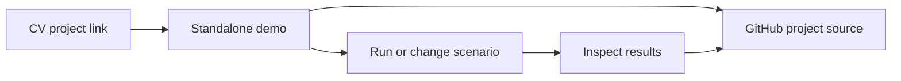

# Dept 3 – Controls and Electrical · Portfolio delivery plan

## Current portfolio scope and department responsibilities

The portfolio has 16 standalone projects plus the integrated factory capstone (Project 14), for 17 total. The seasonal operating baseline is near-daily during active months, with roughly 1,000 kg total per active month, variable daily output, golden tea only when eligible leaf is available, and zero fresh-leaf processing in January–February. Winter packing and shipping draw from released stock. Retail uses 50 g and 100 g bottles. DAY-40 is one synthetic integration test (30 kg green, 10 kg golden; 36 kg bulk and 4 kg retail in 40 × 50 g and 20 × 100 g bottles). MONTH-VAR is a separate synthetic month (994 kg over 29 operating days).

Controls owns timestamps, run state, tag units, data quality and fault histories. Project 15 uses a simulated PLC-to-robot handshake, position and gripper feedback, and recovery without duplicate bottle counts. Project 16 ingests control and BMS signals, with sampling rates and provenance. Project 17 attributes energy to run, wait and idle states. Include a normal dryer completion test in addition to fan loss and deliberate restart.

15. Robotic Packing Cell (/demos/robotic-packing/). Connect checkweighing, reject lane and carton handling. Switch 50 g and 100 g formats, interrupt a pick and verify recovery and exact bottle/carton counts.
16. Factory Data Platform and Analytics (/demos/factory-data/). Ingest stage events and timestamps into Python/SQL, with delivery, lot, batch, pack and order keys. Separate telemetry, material movements, inspection and commercial records. Validate units, IDs, duplicates, missing relationships and stock; show a lot trace and an invalid import.
17. Factory Sustainability and Waste Control (/demos/sustainability/). Compare poor incoming leaf with accepted leaf delayed by a dryer outage. Separate moisture removal, recoverable product, packaging and discard. Route recommendations to Procurement, Quality, Scheduling, Maintenance, Packing, Sales or Building Controls. Record evidence, cause confidence, owner, decision and paired replay outcomes for waste, BDT, energy and service. Quality retains hold/release authority.

Publish each relevant project route with interactive controls, source and observed test evidence. Codex supplies the contract and tests. Antigravity owns assigned UI files. Codex integrates and verifies the demo before public release.

## Recruiter journey

## Department contribution

Own tag lists, conceptual electrical drawings, named station states, timers, alarm causes and recovery conditions. Use SIMATIC, TIA Portal and WinCC as design references. Each control demo needs a signal map and state or control diagram. Record a native project only after legitimate access and actual native validation.

Implement one deterministic scan loop. Make sensor, logic and actuator traces independently observable. Scope the browser PLC demonstration to emulated I/O. In the building module, emulate BACnet/IP points and Modbus meter data and register a reason for stale values. Desigo CC and PXC are design references.

For a PLC application, lead with dryer control and one sequence. For building automation, lead with the SD-anlegg demo and the building alarm matrix, showing ventilation proof, humidity and energy without opening the production route.

This is a delivery plan for the PanchaRupa portfolio. The 17 deliverables share one factory model and one repository. Each has its own demo route and project-specific source folder. Building automation has a separate shareable route within the capstone so it can appear alone on a CV.

## Project delivery cards

### 1. Leaf Intake

- **Target roles:** Industrial automation, PLC and material handling.
- **CV link target:** `<pages-base>/demos/leaf-intake/`.
- **Project source target:** `<repository>/tree/main/projects/leaf-intake/`.
- **Recruiter controls:** Register vendor receipt, enter gross and tare weights, accept or reject a lot, jog a transfer and block the destination buffer.
- **Acceptance scenario:** Use simulated vendor V-01 and lot L-001. Block the buffer after a valid acceptance. Transfer command must drop, the lot must remain assigned, and release must restore eligibility without duplicating issued mass.
- **Evidence to publish:** LAD sequence, scale I/O mapping, handshake timing and receipt event CSV.
- **Release responsibility:** This department signs off its relevant outputs. The demo owner integrates and publishes only after Testing records an observed result.

### 2. Dryer Control

- **Target roles:** PLC, process control and commissioning.
- **CV link target:** `<pages-base>/demos/dryer-control/`.
- **Project source target:** `<repository>/tree/main/projects/dryer-control/`.
- **Recruiter controls:** Adjust temperature setpoint, start a batch, inject a fan proof failure, acknowledge, clear and restart. Toggle timer and PID scenarios if implemented.
- **Acceptance scenario:** Compare clean start with fan proof loss. Trend measured temperature, setpoint and heat command. Confirm modeled heat command drops on lost proof and acknowledgement alone cannot restore it. Label any moisture estimator or MPC comparison as an optional extension with held-out simulated batches.
- **Evidence to publish:** FBD or ST design, control narrative, alarm cause-and-effect, trend CSV and tests.
- **Release responsibility:** This department signs off its relevant outputs. The demo owner integrates and publishes only after Testing records an observed result.

### 3. Green Tea Sequence

- **Target roles:** PLC sequencing and production automation.
- **CV link target:** `<pages-base>/demos/green-tea-sequence/`.
- **Project source target:** `<repository>/tree/main/projects/green-tea-sequence/`.
- **Recruiter controls:** Select a green tea recipe, start a lot, step the line, disable roller availability and restore it.
- **Acceptance scenario:** Confirm the heated drum precedes rolling, and rolling precedes drying. While the roller is busy, retain batch ID and show waiting reason. Require completed handoff before incrementing output.
- **Evidence to publish:** Sequence diagram, per-station permissives, simulated recipe and batch timeline.
- **Release responsibility:** This department signs off its relevant outputs. The demo owner integrates and publishes only after Testing records an observed result.

### 4. Withering Airflow

- **Target roles:** Process control, instrumentation and energy.
- **CV link target:** `<pages-base>/demos/withering-airflow/`.
- **Project source target:** `<repository>/tree/main/projects/withering-airflow/`.
- **Recruiter controls:** Set fan command and initial moisture, change the ambient scenario, pause or accelerate and compare two runs.
- **Acceptance scenario:** Use the same batch with two airflow settings. Show modeled moisture trajectory and fan hours. An invalid moisture reading must be flagged. Keep assumed drying parameters visible.
- **Evidence to publish:** Airflow I/O map, simplified model notes, sensitivity plot and CSV.
- **Release responsibility:** This department signs off its relevant outputs. The demo owner integrates and publishes only after Testing records an observed result.

### 5. Golden Tea Sequence

- **Target roles:** Batch automation and commissioning.
- **CV link target:** `<pages-base>/demos/golden-tea-sequence/`.
- **Project source target:** `<repository>/tree/main/projects/golden-tea-sequence/`.
- **Recruiter controls:** Start a golden tea batch, select an oxidation profile, confirm completion and reserve the shared dryer.
- **Acceptance scenario:** Verify withering → rolling → oxidation → drying. Block premature transfer and show a second batch waiting on a reserved dryer. Never allow both batches to own it simultaneously.
- **Evidence to publish:** Recipe table, interlock trace, resource reservation tests and batch report.
- **Release responsibility:** This department signs off its relevant outputs. The demo owner integrates and publishes only after Testing records an observed result.

### 6. Grading And Routing

- **Target roles:** Quality engineering, PLC routing and traceability.
- **CV link target:** `<pages-base>/demos/grading-and-routing/`.
- **Project source target:** `<repository>/tree/main/projects/grading-and-routing/`.
- **Recruiter controls:** Inspect a simulated finished lot, assign a grade, hold or release it, then make a destination bin unavailable.
- **Acceptance scenario:** Route only released material. Stop routing on full bin and preserve source ID. Honor a valid disposition after acknowledgement. Show upstream-to-downstream trace and quantity conservation.
- **Evidence to publish:** Disposition rules, state table, lot genealogy and fault log.
- **Release responsibility:** This department signs off its relevant outputs. The demo owner integrates and publishes only after Testing records an observed result.

### 7. Packing And Reject

- **Target roles:** Machine automation, instrumentation and quality.
- **CV link target:** `<pages-base>/demos/packing-and-reject/`.
- **Project source target:** `<repository>/tree/main/projects/packing-and-reject/`.
- **Recruiter controls:** Choose bulk bag or retail bottle, set target weight, use simulated coarse and fine dosing, inject underfill and attempt dispatch.
- **Acceptance scenario:** Show actual versus target weight. Reject the underfill, keep it outside dispatch, and preserve its source lot. Allow valid packs into the allocated channel exactly once.
- **Evidence to publish:** Weighing logic, I/O list, test weights and reject/event export.
- **Release responsibility:** This department signs off its relevant outputs. The demo owner integrates and publishes only after Testing records an observed result.

### 13. Maintenance Planning

- **Target roles:** Reliability, maintenance planning and commissioning.
- **CV link target:** `<pages-base>/demos/maintenance-planning/`.
- **Project source target:** `<repository>/tree/main/projects/maintenance-planning/`.
- **Recruiter controls:** Open a dryer work order, schedule a service window, inject a failure and compare planned versus unplanned loss.
- **Acceptance scenario:** Show runtime and outage, queued batches and delayed dispatch. The work order must link to an asset, failure event and schedule decision. Keep SAP as workflow reference unless actually used.
- **Evidence to publish:** Asset register, work-order sample, fault trace and downtime comparison.
- **Release responsibility:** This department signs off its relevant outputs. The demo owner integrates and publishes only after Testing records an observed result.

### 14. Virtual Factory

- **Target roles:** Systems engineering, commissioning and industrial automation.
- **CV link target:** `<pages-base>/demos/virtual-factory/`.
- **Project source target:** `<repository>/tree/main/projects/virtual-factory/`.
- **Recruiter controls:** Select factory configuration, run a batch or month, inject dryer failure, inspect production and SD-anlegg views, and export results.
- **Acceptance scenario:** Replay the same order book across the five configurations. Show reported 100 and 1,000 kg/month separately from simulation. Compare utilization, throughput, cost and lateness. Check fan proof loss, humidity and stale meter alarms in the BMS view.
- **Evidence to publish:** System diagram, test matrix, scale-up case study, reproducible scenario files and evidence exports.
- **Release responsibility:** This department signs off its relevant outputs. The demo owner integrates and publishes only after Testing records an observed result.

## Shareable building automation route

Use `<pages-base>/demos/building-automation/` and `<repository>/tree/main/projects/virtual-factory/building-automation/`. Load an operations-day fixture with fan schedule and room humidity already visible. Allow the recruiter to command the fan, inject missing proof, acknowledge the alarm, restore proof, and change humidity or stop meter updates. Show alarms, event history and kWh per released kg over matching production periods. Provide the building point list, alarm matrix and energy trend. Describe BACnet/IP and Modbus values as emulated and Desigo CC and PXC as references until actual native work is performed.

## Link and source contract

- Use an independent static entry for every demo so opening or refreshing the CV URL works on GitHub Pages. Build links relative to the repository subpath. Never require a recruiter to navigate the factory menu before trying the selected project.
- The demo header includes the project title, a short action prompt, **View project source**, **View test evidence**, and **Reset**. Project source opens the relevant GitHub directory and README rather than the repository root. The README links back to the live demo and lists required dependencies, data origin and run commands.
- Each project folder contains a README, source or clearly attributed shared source links, fixture inputs, expected and observed evidence, and technical diagrams where relevant. Identify the exact environment used and link test evidence to the source revision.
- Use a browser-first, login-free experience with illustrative data. Avoid actual supplier, employee or customer names. Keep all URLs shown in this plan as placeholders until deployment checks pass. Add permanent live URLs to the CV only after verifying them independently.
- One example of the intended PLC application path is **Tea Dryer Control — Interactive PLC Simulation** → dryer demo → Start batch → Fan proof failure → live trend and alarm history → View project source → FBD, I/O list and test results. The page identifies which behavior was tested and where.
- Select one or two links per application. Put the relevant action or evidence in the CV text so the reviewer knows what they can try. Use observed test outcomes only after execution.

## Delivery and review gates

1. **Specification.** Agree on operator actions, preloaded fixture, department handoffs, expected outputs, evidence filenames and reference products. Historical recollection and example settings should have separate fields.
2. **Implementation after 16 December 2026.** Build the first PLC dryer project end to end. Reuse its link, reset, evidence and source conventions across the other modules.
3. **Verification.** Test direct launch, nominal interaction, fault or infeasible case, reset, reload, narrow screen, and keyboard use. Re-run results from the documented fixture. Confirm both public links work from an unauthenticated session before release.
4. **Publication.** Link each verified artifact from the portfolio index and the project README. Keep private records out of the repository. Use the project link in a CV once its public demo and evidence are ready.
5. **Maintenance.** Recheck the published demo and source links after changing routes, branches, scenario data or deployment. Preserve shareable URLs when practical and date the test evidence.

## Positioning

The factory case study is anchored in the founder-reported growth from 100 to 1,000 kg/month. Label simulated outputs, BDT scenarios and engineering assumptions. Siemens, BMS, ERP and analytics products appear as tools used or reference workflows according to what was actually implemented and tested. The virtual build starts with no purchased PLC hardware or vendor licenses.
