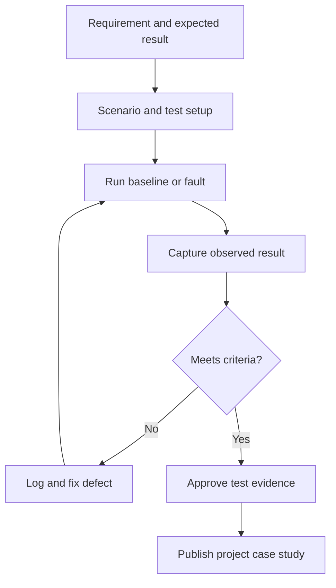

# Dept 6 – Testing and Portfolio

## Current portfolio scope and department responsibilities

The portfolio has 16 standalone projects plus the integrated factory capstone (Project 14), for 17 total. The seasonal operating baseline is near-daily during active months, with roughly 1,000 kg total per active month, variable daily output, golden tea only when eligible leaf is available, and zero fresh-leaf processing in January–February. Winter packing and shipping draw from released stock. Retail uses 50 g and 100 g bottles. DAY-40 is one synthetic integration test (30 kg green, 10 kg golden; 36 kg bulk and 4 kg retail in 40 × 50 g and 20 × 100 g bottles). MONTH-VAR is a separate synthetic month (994 kg over 29 operating days).

Test robot interrupted pick, barcode and pack counts; data import duplicates, orphan keys, invalid readings and reconciled stock; sustainability paired replay with identical inputs and confirmed/suspected/unknown causes. Verify waste classification, net credits and energy denominators. Also verify every direct CV link, restart/reset, source link and observed test evidence. Record source revision and scenario version.

## Working block diagram

## Purpose and PanchaRupa history

This department owns the workflow above and signs off on its handoffs. One person may cover several roles. PanchaRupa produced green tea and golden tea, a specialty black tea, from mostly vendor-supplied hand-picked leaves. The founder recalls adding a heated drum for early heat treatment, then automating final drying, then introducing a rolling machine. Monthly output reportedly rose from **100 to 1,000 kg**. Most tea went in bulk bags to the Chattogram auction channel. Some went into plastic retail bottles. Exact historical recipes, machine specifications, costs and intermediate production figures are unknown. This handbook specifies a proposed virtual workflow and a hypothetical low-cost physical configuration.

### Design acceptance checks
Give each requirement a stable ID and link it to a scenario with known starting conditions, a trigger, expected behavior and observed result. Cover both tea routes, five configurations, resource conflicts, product changeovers, loss of power, dryer failure, incorrect packing, quality hold and forward or backward trace. Test fan failure, humidity and stale meter signals separately from PLC process interlocks.

### Run the DAY-40 integration test
Expect 30 kg green and 10 kg golden, with 36 kg bulk and 4 kg retail in 40 × 50 g and 20 × 100 g bottles. Verify no concurrent reservation of shared machines, no packing of held stock, exact identification of each dispatch and reconciled released mass. In the fault run, compare against the baseline and record lost or delayed dispatches as observed. Test the roster after removal of a qualified worker.

### Assemble interview material
Each of the 13 modules and integrated capstone gets a use case, diagram, exact tools, role, data origin, link and one reproducible test. Distinguish hardware, native software and browser tests by their actual environment. Use the five-configuration experiment to report modeled differences in bottlenecks and labor. Mark the historical 100 and 1,000 kg/month figures as founder-reported. Keep private recipes or real customer details outside public examples.

## Machines, tools and investment

| Hypothetical asset or tool | Illustrative BDT | Purpose |
|---|---:|---|
| Physical commissioning test fixtures and references | 15,000 | Hypothetical reusable verification kit for the physical factory. |
| Commissioning and operator training setup | 10,000 | One-off launch allowance tracked separately from the depreciable fixture. |
| **Department startup funding** | **25,000** | Before working capital. |

## How the department gets its budget

Request physical verification funds per equipment acceptance stage. Separate initial training from reusable test assets and track recurring checks as factory QA/verification overhead. Zero-cost portfolio validation uses the browser and synthetic data. Keep portfolio writing, screenshots and interview preparation outside factory cost of goods.

1. The department lead submits a request with asset or operating item, units, specification, alternatives, reason, required date and cost center.
2. Operations checks utilization, batch forecasts and bottlenecks. The requesting lead estimates released kg gained, time saved, failure exposure reduced or a test requirement met.
3. Finance separates capital, one-time startup costs, recurring production costs, working capital and selling costs. It checks committed spend and projected cash before approval.
4. The founder approves a spending ceiling. For physical purchasing, obtain actual quotes and record landed and installed cost, local support and spare parts. Match approved purchase, receipt and invoice.
5. At month-end, compare budget, committed spend and actuals. Split material differences into quantity, price and timing. Record the corrective owner and revise the next forecast.

## How this department costs the tea

| Department cost pool | BDT/month |
|---|---:|
| Recurring physical checks and test consumables | 2,000 |
| **Recurring factory cash budget** | **2,000** |
| Illustrative depreciation | 250 |
| **Monthly manufacturing allocation** | **2,250** |

This department contributes **BDT 2.25 per released kg** at 1,000 kg/month. Cost driver: Routine physical verification by test hours or runs. Portfolio work is excluded from tea unit cost. Assign identifiable costs to a specific batch or sales channel first. Allocate the remaining pool by each product’s share of the stated driver. Reconcile direct charges, allocated overhead and period variances to the ledger. Keep the same electricity meter, machine, labor and quality cost with one budget owner.

## Shared factory budget and reconciliation

These numbers are **synthetic BDT planning allowances**, not prices researched in Panchagarh or historical PanchaRupa accounts. The virtual project assumes an existing computer and browser with zero incremental software and equipment spend. The physical example is an exercise in investment and production costing.

| Department | Startup funding (BDT) | Recurring factory cash (BDT/month) |
|---|---:|---:|
| Production Engineering | 350,000 | 26,000 |
| Capacity and Operations | 40,000 | 8,000 |
| Controls and Electrical | 165,000 | 12,000 |
| Quality and Traceability | 55,000 | 6,000 |
| HMI and Simulation | 0 | 0 |
| Testing and Portfolio | 25,000 | 2,000 |
| Business Operations and Planning | 25,000 | 7,000 |
| **Total departmental funding** | **660,000** | **61,000** |

Treat BDT 10,000 of the startup total as one-off commissioning and training. Use BDT 650,000 as the example depreciation base. Straight-line allocation over 60 months with zero residual gives BDT 10,833.33/month. These are modeling choices.

### Design month and direct materials

In the illustrative 1,000 kg costing model, a 25% aggregate net yield implies 4,000 kg of fresh leaf at BDT 25/kg. The 1,000 kg costing case is independent of the variable 994 kg active-month fixture. Apply product-specific yields to live scenario inputs.

Use a 90% bulk / 10% retail split. The bulk example uses 36 bags of 25 kg at BDT 50 per bag. The costing example uses 800 × 50 g bottles at BDT 4 and 600 × 100 g bottles at BDT 8. Confirm pack sizes and commercial requirements before any physical use.

| Worked cost bridge | BDT/month | BDT per released kg |
|---|---:|---:|
| Fresh leaf | 100,000 | 100.00 |
| Bulk bags and retail bottles | 9,800 | 9.80 |
| Departmental recurring factory cash | 61,000 | 61.00 |
| Depreciation | 10,833.33 | 10.83 |
| **Illustrative manufacturing cost** | **181,633.33** | **181.63** |
| Bulk outbound freight, tracked as selling expense | 9,000 | 9.00 plant-wide or 10.00 per bulk kg |

Packaging adds BDT 2 per bulk kg and BDT 80 per retail kg before labor or yield differences. The plant-wide figure is cost per released kg. Recognize cost against sales using opening stock, production, shipped quantities and closing stock. Track broker fees, retail delivery, rent, taxes, site works and finance separately when figures become available. They are outside this simplified cost bridge.

Recurring factory cash in the example is BDT 170,800/month, or BDT 179,800 with bulk outbound. The startup budget plus one example month of that cash spend comes to **BDT 839,800**. Estimate actual working capital from dated vendor payments, wage cycles, stock and cash settlement. Stress-test delayed auction receipts. Build the 100 kg/month configuration with its own labor and asset assumptions. Intermediate upgrade outputs are simulated.

## Build, test and sign off

1. Record input/output fields, owning roles, approval points and the interface with adjacent departments. Agree on the exact machine states and the event or record that closes each handoff.
2. After 16 December 2026, make the block diagram executable in the simulator or planning workbook. First verify one green batch, then add golden tea and both packing branches.
3. Run the DAY-40 integration test. Check quantity and lot reconciliation, no overlapping shared-machine reservations, and correct channel allocation. Repeat with a dryer outage and report delays and costs from the run.
4. Record the scenario version, expected result, observed result, deviations and owner. Sign off only when the applicable checks pass. Publish a standalone case study or demo link with the exact tools and data used.

[Existing department plan](https://docs.google.com/document/d/1WcOyPEq2HB6HAK1cyXBPDfRCUArjipvUCmjUkZDohFY/edit)
