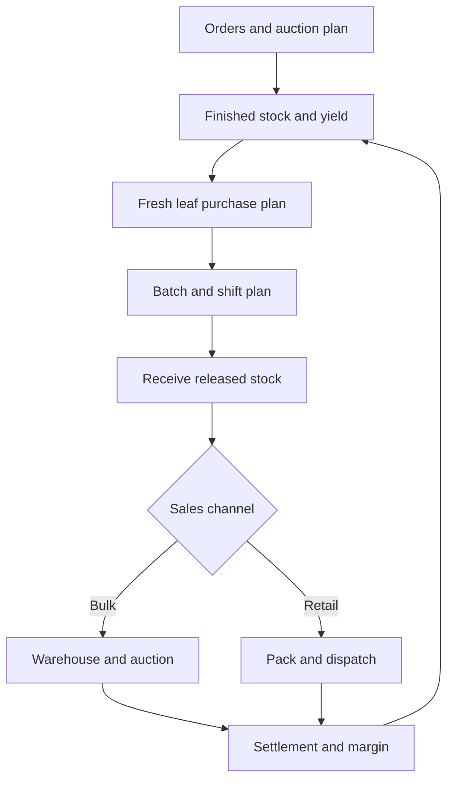

# Dept 7 – Business Operations and Planning

## Current portfolio scope and department responsibilities

The portfolio has 16 standalone projects plus the integrated factory capstone (Project 14), for 17 total. The seasonal operating baseline is near-daily during active months, with roughly 1,000 kg total per active month, variable daily output, golden tea only when eligible leaf is available, and zero fresh-leaf processing in January–February. Winter packing and shipping draw from released stock. Retail uses 50 g and 100 g bottles. DAY-40 is one synthetic integration test (30 kg green, 10 kg golden; 36 kg bulk and 4 kg retail in 40 × 50 g and 20 × 100 g bottles). MONTH-VAR is a separate synthetic month (994 kg over 29 operating days).

Own procurement invoices and credits, selling and settlement events, stock policy and costing. Extend Project 12 with cost centres and overhead drivers, break-even and contribution, auction/retail/winter allocation, scenario-based price elasticity, and dryer NPV/payback. Assign action owners for Project 17 and replay proposed supplier, inventory and maintenance changes. Value waste separately within purchase costs to avoid double counting.

## Working block diagram

## Purpose and PanchaRupa history

This department owns the workflow above and signs off on its handoffs. One person may cover several roles. PanchaRupa produced green tea and golden tea, a specialty black tea, from mostly vendor-supplied hand-picked leaves. The founder recalls adding a heated drum for early heat treatment, then automating final drying, then introducing a rolling machine. Monthly output reportedly rose from **100 to 1,000 kg**. Most tea went in bulk bags to the Chattogram auction channel. Some went into plastic retail bottles. Exact historical recipes, machine specifications, costs and intermediate production figures are unknown. This handbook specifies a proposed virtual workflow and a hypothetical low-cost physical configuration.

### Plan purchases and staffing
Net the dated order book against released stock by product and channel. Translate the deficit into fresh leaf using product-specific net yield. Compare vendor price, accepted quantity and lead time. Produce a dated order schedule and flag shortages. Build the worker roster from availability, qualifications, labor minutes and overlapping tasks, then compare with a fixed roster. Use Python and OR-Tools as optional implementation tools and Excel tables as the planning interface.

### Manage capacity and inventory commitments
Schedule both teas around the shared roller and dryer. Reserve only released stock. Maintain the stock and packaging ledger by lot and use plan-versus-actual views in Excel and Power Query. Keep supplier orders, production orders, finished inventory and dispatched quantities separate. Treat demand forecasting as a later module if dated evidence becomes available. Synthetic demand can test decisions and failure modes.

### Sell, settle and cost
For bulk shipments capture bag weight, bag ID, samples, warehouse and broker milestones, sale price, charges and payment date. For retail capture bottle quantity, fill weight, packaging spend, dispatch and channel revenue. Compute delivered contribution by tea and channel. Report working capital tied up in inventory and receivables separately from monthly expense. Use an Excel or Power BI portfolio view when access allows. Model maintenance requests, work orders and asset downtime using SAP maintenance workflow terminology as reference.

## Machines, tools and investment

| Hypothetical asset or tool | Illustrative BDT | Purpose |
|---|---:|---|
| Dispatch scale, label and basic office equipment allowance | 25,000 | Issue manifests, verify outgoing quantities and retain settlement or retail order records. |
| **Department startup funding** | **25,000** | Before working capital. |

## How the department gets its budget

Prepare a monthly rolling plan for raw leaf, bags, bottles, labor, logistics and small operating supplies. Give Finance the purchase schedule, cash timing and expected settlement. Approve capital independently of leaf and packaging inventory. Record 100,000 BDT monthly leaf, 9,800 BDT product packing and 9,000 BDT bulk outbound as separate worked-example lines. Keep outbound selling costs below factory COGS in the profitability view and assign channel costs by actual order or shipment.

1. The department lead submits a request with asset or operating item, units, specification, alternatives, reason, required date and cost center.
2. Operations checks utilization, batch forecasts and bottlenecks. The requesting lead estimates released kg gained, time saved, failure exposure reduced or a test requirement met.
3. Finance separates capital, one-time startup costs, recurring production costs, working capital and selling costs. It checks committed spend and projected cash before approval.
4. The founder approves a spending ceiling. For physical purchasing, obtain actual quotes and record landed and installed cost, local support and spare parts. Match approved purchase, receipt and invoice.
5. At month-end, compare budget, committed spend and actuals. Split material differences into quantity, price and timing. Record the corrective owner and revise the next forecast.

## How this department costs the tea

| Department cost pool | BDT/month |
|---|---:|
| Shared manufacturing planning labor | 7,000 |
| **Recurring factory cash budget** | **7,000** |
| Illustrative depreciation | 416.67 |
| **Monthly manufacturing allocation** | **7,416.67** |

This department contributes **BDT 7.42 per released kg** at 1,000 kg/month. Cost driver: Direct order or packing costs by sales channel. Shared manufacturing planning by production orders or hours. Assign identifiable costs to a specific batch or sales channel first. Allocate the remaining pool by each product’s share of the stated driver. Reconcile direct charges, allocated overhead and period variances to the ledger. Keep the same electricity meter, machine, labor and quality cost with one budget owner.

## Shared factory budget and reconciliation

These numbers are **synthetic BDT planning allowances**, not prices researched in Panchagarh or historical PanchaRupa accounts. The virtual project assumes an existing computer and browser with zero incremental software and equipment spend. The physical example is an exercise in investment and production costing.

| Department | Startup funding (BDT) | Recurring factory cash (BDT/month) |
|---|---:|---:|
| Production Engineering | 350,000 | 26,000 |
| Capacity and Operations | 40,000 | 8,000 |
| Controls and Electrical | 165,000 | 12,000 |
| Quality and Traceability | 55,000 | 6,000 |
| HMI and Simulation | 0 | 0 |
| Testing and Portfolio | 25,000 | 2,000 |
| Business Operations and Planning | 25,000 | 7,000 |
| **Total departmental funding** | **660,000** | **61,000** |

Treat BDT 10,000 of the startup total as one-off commissioning and training. Use BDT 650,000 as the example depreciation base. Straight-line allocation over 60 months with zero residual gives BDT 10,833.33/month. These are modeling choices.

### Design month and direct materials

In the illustrative 1,000 kg costing model, a 25% aggregate net yield implies 4,000 kg of fresh leaf at BDT 25/kg. The 1,000 kg costing case is independent of the variable 994 kg active-month fixture. Apply product-specific yields to live scenario inputs.

Use a 90% bulk / 10% retail split. The bulk example uses 36 bags of 25 kg at BDT 50 per bag. The costing example uses 800 × 50 g bottles at BDT 4 and 600 × 100 g bottles at BDT 8. Confirm pack sizes and commercial requirements before any physical use.

| Worked cost bridge | BDT/month | BDT per released kg |
|---|---:|---:|
| Fresh leaf | 100,000 | 100.00 |
| Bulk bags and retail bottles | 9,800 | 9.80 |
| Departmental recurring factory cash | 61,000 | 61.00 |
| Depreciation | 10,833.33 | 10.83 |
| **Illustrative manufacturing cost** | **181,633.33** | **181.63** |
| Bulk outbound freight, tracked as selling expense | 9,000 | 9.00 plant-wide or 10.00 per bulk kg |

Packaging adds BDT 2 per bulk kg and BDT 80 per retail kg before labor or yield differences. The plant-wide figure is cost per released kg. Recognize cost against sales using opening stock, production, shipped quantities and closing stock. Track broker fees, retail delivery, rent, taxes, site works and finance separately when figures become available. They are outside this simplified cost bridge.

Recurring factory cash in the example is BDT 170,800/month, or BDT 179,800 with bulk outbound. The startup budget plus one example month of that cash spend comes to **BDT 839,800**. Estimate actual working capital from dated vendor payments, wage cycles, stock and cash settlement. Stress-test delayed auction receipts. Build the 100 kg/month configuration with its own labor and asset assumptions. Intermediate upgrade outputs are simulated.

## Build, test and sign off

1. Record input/output fields, owning roles, approval points and the interface with adjacent departments. Agree on the exact machine states and the event or record that closes each handoff.
2. After 16 December 2026, make the block diagram executable in the simulator or planning workbook. First verify one green batch, then add golden tea and both packing branches.
3. Run the DAY-40 integration test. Check quantity and lot reconciliation, no overlapping shared-machine reservations, and correct channel allocation. Repeat with a dryer outage and report delays and costs from the run.
4. Record the scenario version, expected result, observed result, deviations and owner. Sign off only when the applicable checks pass. Publish a standalone case study or demo link with the exact tools and data used.

[Existing department plan](https://docs.google.com/document/d/1msj8Gkj4XZjjMZhBSyBQfbrvTpxaYr-bEaHjH5X9S84/edit)
