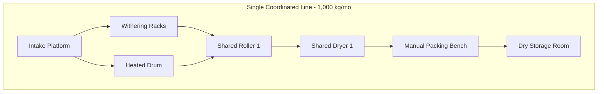
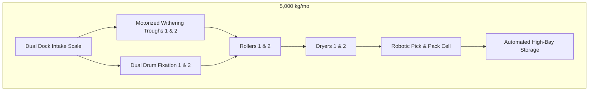

# Factory Master Plan — Opening Day vs Fifth-Year Expansion

## 1. Physical Layout Comparison

### Opening-Day Configuration (Year 1)
- **Target Output:** 1,000 kg released tea / month.
- **Footprint:** $30\text{ m} \times 15\text{ m}$ ($450\text{ m}^2$) pre-engineered steel building.
- **Process Line 1:**
  - Intake Weigh Platform (250 kg scale).
  - Green Tea Heated Drum (Fixation).
  - Withering Tray Rack 1 (40 kg capacity).
  - Shared Single Roller (30 kg batch).
  - Shared Final Dryer (single 60 kg chamber).
  - Manual Packing Bench & Inspection table.
- **Utilities:** 50 kVA 400V grid drop, 15 kW backup diesel generator, localized roof exhaust hoods.

---

### Fifth-Year Expansion Configuration (Year 5)
- **Target Output:** 5,000 kg released tea / month.
- **Expanded Footprint:** $60\text{ m} \times 25\text{ m}$ ($1,500\text{ m}^2$).
- **Process Line 2 Added (Parallel):**
  - Continuous green tea steam/drum fixation unit.
  - Trough withering bay with motorized plenum ducting (250 kg capacity).
  - Roller 2 (high-capacity 60 kg table).
  - Final Dryer 2 (dual-stage fluidized bed).
  - Robotic Packing Cell (automated carton casing).
  - High-cube racked dry warehouse with dehumidification AHU.
- **Utilities:** 150 kVA dedicated pad-mounted transformer, central compressed air plant (7.5 bar), centralized dust extraction baghouse.

---

## 2. Early Enabling vs Retrofit Cost Trade-Off Analysis

| Category | Option A: Early Enabling (Built into Year 1) | Option B: Retrofit & Deferral (Added in Year 5) | Variance & Savings |
|---|---:|---:|---|
| **Substation & Cable Trays** | Install 150 kVA main distribution panel with blank breakers: **BDT 120,000** | Replace 50 kVA panel, trench concrete slab, rewire: **BDT 340,000** | Save BDT 220,000 + avoid 10 days shutdown |
| **Foundation Pits & Sumps** | Cast dual machine recessed pits & drainage trenches: **BDT 55,000** | Saw-cut cured concrete floor, pneumatic jackhammering: **BDT 190,000** | Save BDT 135,000 + prevent silica dust contamination |
| **Piping & Steam Manifolds** | Install oversized 3" main manifold with blanked tees: **BDT 45,000** | Hot-tap live steam lines or shut down boiler for welding: **BDT 145,000** | Save BDT 100,000 |
| **Structural Bay Clearance** | Span 6m column bays with clear 4.5m hook height: **BDT 30,000** | Structural truss modification for overhead crane: **BDT 175,000** | Save BDT 145,000 |
| **Total Enabling Capital** | **BDT 250,000** | **BDT 850,000** | **Net Capital & Downtime Savings: BDT 600,000** |
