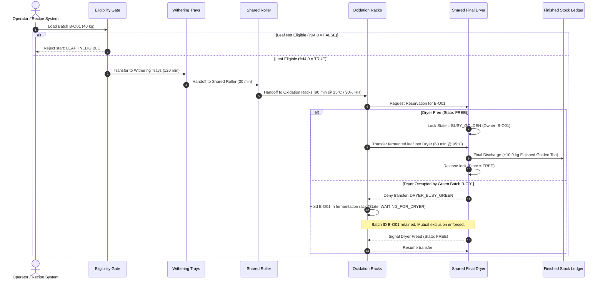

# Golden Tea Sequence & Shared-Dryer Arbitration Logic

## 1. Process Sequence Diagram

---

## 2. Shared-Dryer State Transition Table

| Current State | Event / Trigger | Next State | Allowed Actions |
|---|---|---|---|
| `FREE` | Golden batch requests reservation | `RESERVED_GOLDEN` | Dryer heater preheats to 95°C |
| `RESERVED_GOLDEN` | Golden leaf transferred into dryer | `BUSY_GOLDEN` | Green tea requests denied / held |
| `BUSY_GOLDEN` | Drying cycle finishes & discharged | `FREE` | Unlocks next waiting batch |
| `FREE` | Green batch requests reservation | `RESERVED_GREEN` | Golden tea requests denied / held |
| `BUSY_GREEN` | Golden batch requests reservation | `BUSY_GREEN` | Golden batch placed in `WAITING_FOR_DRYER` |
| `BUSY_GREEN` | Green cycle finishes & discharged | `FREE` | Unlocks waiting Golden batch |

---

## 3. Mutual Exclusion Interlock Rules

1. `Dryer_Owner_Batch_ID` register holds the active batch identifier.
2. `DO_DRYER_INFEED_GATE` can only open if `Dryer_State == FREE` or `Dryer_Owner_Batch_ID == Active_Batch_ID`.
3. Simultaneous entry of green and golden tea is mechanically and electronically locked out to prevent catastrophic product cross-contamination.
