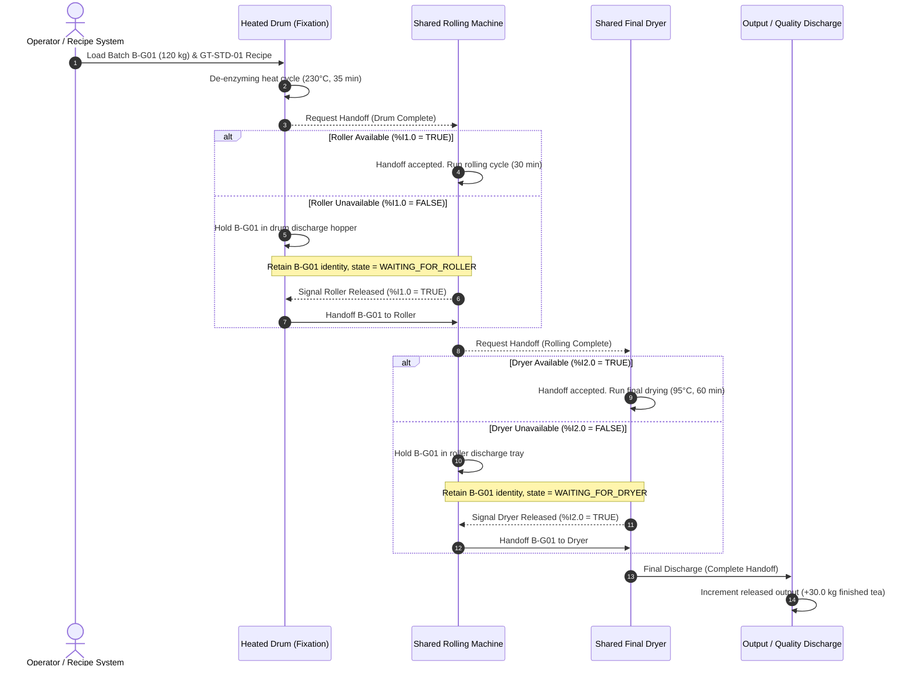

# Green Tea Sequence — Control Narrative & Permissives

## 1. Process Sequence Diagram

---

## 2. Per-Station Permissives Matrix

| Station | Run Permissive Requirements | Interlock Hold Conditions | Tag Addresses |
|---|---|---|---|
| **Heated Drum** | `Recipe Selected` AND `Drum Infeed Gate Closed` AND `Heater Zone 1/2 >= 200°C` | E-stop tripped OR Door open | Permissive: `%M10.0`, Run: `%Q1.0` |
| **Shared Roller** | `Drum Cycle Complete` AND `Roller Available (%I1.0 = TRUE)` AND `Roller Bed Clean` | Roller occupied by Golden batch OR Maintenance lockout | Permissive: `%M10.1`, Run: `%Q1.1` |
| **Shared Dryer** | `Roller Cycle Complete` AND `Dryer Available (%I2.0 = TRUE)` AND `Airflow Proof OK` | Dryer running or reserved by another batch | Permissive: `%M10.2`, Run: `%Q1.2` |
| **Discharge Ledger**| `Dryer Cycle Complete` AND `Discharge Valve Confirmed Open` | Missing discharge handshake | Permissive: `%M10.3`, Increment: `%Q1.3` |

---

## 3. Waiting Reason & Batch Identity Preservation

- **Inviolable Rule:** No batch mass or identifier may be cleared or discarded due to downstream delay.
- While waiting for roller availability:
  - Batch register `REG_ACTIVE_BATCH_ID` retains `B-G01`.
  - Machine state register `REG_LINE_STATE` indicates `WAITING_FOR_ROLLER` (`Code: 104`).
  - HMI displays operator message: `HOLD: Shared roller occupied by Batch B-O01`.
- While waiting for dryer availability:
  - Batch register `REG_ACTIVE_BATCH_ID` retains `B-G01`.
  - Machine state register `REG_LINE_STATE` indicates `WAITING_FOR_DRYER` (`Code: 108`).
  - HMI displays operator message: `HOLD: Shared dryer reserved`.
