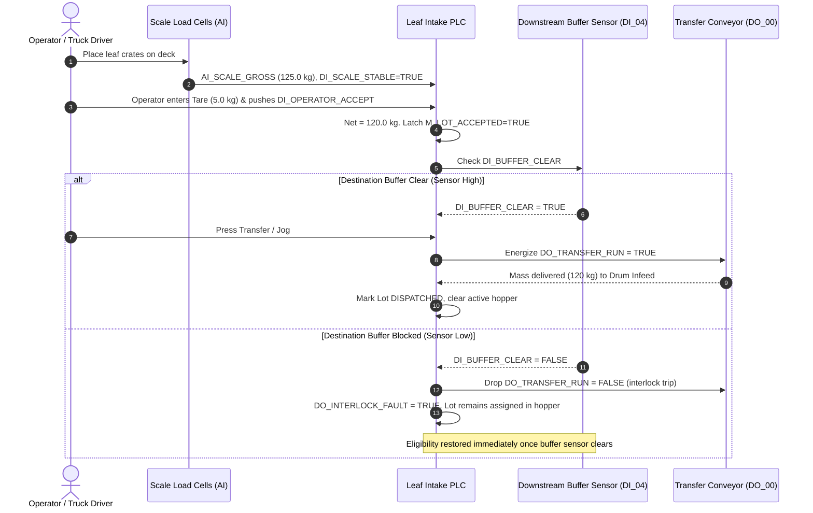

# Leaf Intake — Control Logic & I/O Specifications

## 1. Scale & Interlock I/O Mapping

| Tag Name | Address | Type | Engineering Units / State | Description |
|---|---|---|---|---|
| `AI_SCALE_GROSS` | `%IW64` | `INT` | 0–300.0 kg (0.1 kg res) | Intake platform load-cell gross weight |
| `AI_SCALE_TARE` | `%IW66` | `INT` | 0–50.0 kg (0.1 kg res) | Container tare weight |
| `DI_SCALE_STABLE` | `%I0.0` | `BOOL` | TRUE = Stable | Scale weight stabilization indicator (±0.05 kg for 1.5s) |
| `DI_OPERATOR_ACCEPT` | `%I0.1` | `BOOL` | Momentary PB | Operator inspection acceptance pushbutton |
| `DI_OPERATOR_REJECT` | `%I0.2` | `BOOL` | Momentary PB | Operator inspection rejection pushbutton |
| `DI_BUFFER_CLEAR` | `%I0.3` | `BOOL` | TRUE = Clear, FALSE = Blocked | Optical / high-level sensor at destination hopper |
| `DI_TRANSFER_JOG` | `%I0.4` | `BOOL` | Momentary PB | Manual jog transfer command |
| `DO_TRANSFER_RUN` | `%Q0.0` | `BOOL` | TRUE = Energize Motor | Transfer conveyor drive run contactor |
| `DO_INTERLOCK_FAULT` | `%Q0.1` | `BOOL` | TRUE = Alarm Lamp | Buffer blocked / scale error alarm beacon |
| `DO_ACCEPT_PILOT` | `%Q0.2` | `BOOL` | TRUE = Green Pilot | Lot accepted indicator |
| `DO_REJECT_PILOT` | `%Q0.3` | `BOOL` | TRUE = Red Pilot | Lot rejected indicator |

---

## 2. Ladder Logic (LAD) Representation

```text
[Rung 1: Permissive Check - Gross > Tare & Scale Stable]
   DI_SCALE_STABLE     [ AI_SCALE_GROSS > AI_SCALE_TARE ]          M_SCALE_VALID
---------| |------------------------[ > ]-----------------------------( )----

[Rung 2: Lot Acceptance Latch]
   M_SCALE_VALID       DI_OPERATOR_ACCEPT     DI_OPERATOR_REJECT   M_LOT_ACCEPTED
---------| |-------------------| |--------------------|/|-------------( S )----

[Rung 3: Lot Rejection Latch]
   M_SCALE_VALID       DI_OPERATOR_REJECT     DI_OPERATOR_ACCEPT   M_LOT_REJECTED
---------| |-------------------| |--------------------|/|-------------( S )----

[Rung 4: Transfer Interlock & Run Command]
   M_LOT_ACCEPTED      DI_BUFFER_CLEAR        DI_TRANSFER_JOG      DO_TRANSFER_RUN
---------| |-------------------| |--------------------| |-------------( )----

[Rung 5: Blocked Buffer Alarm Beacon]
   M_LOT_ACCEPTED      DI_BUFFER_CLEAR                             DO_INTERLOCK_FAULT
---------| |-------------------|/|------------------------------------( )----
```

---

## 3. Handshake & Timing Diagram


