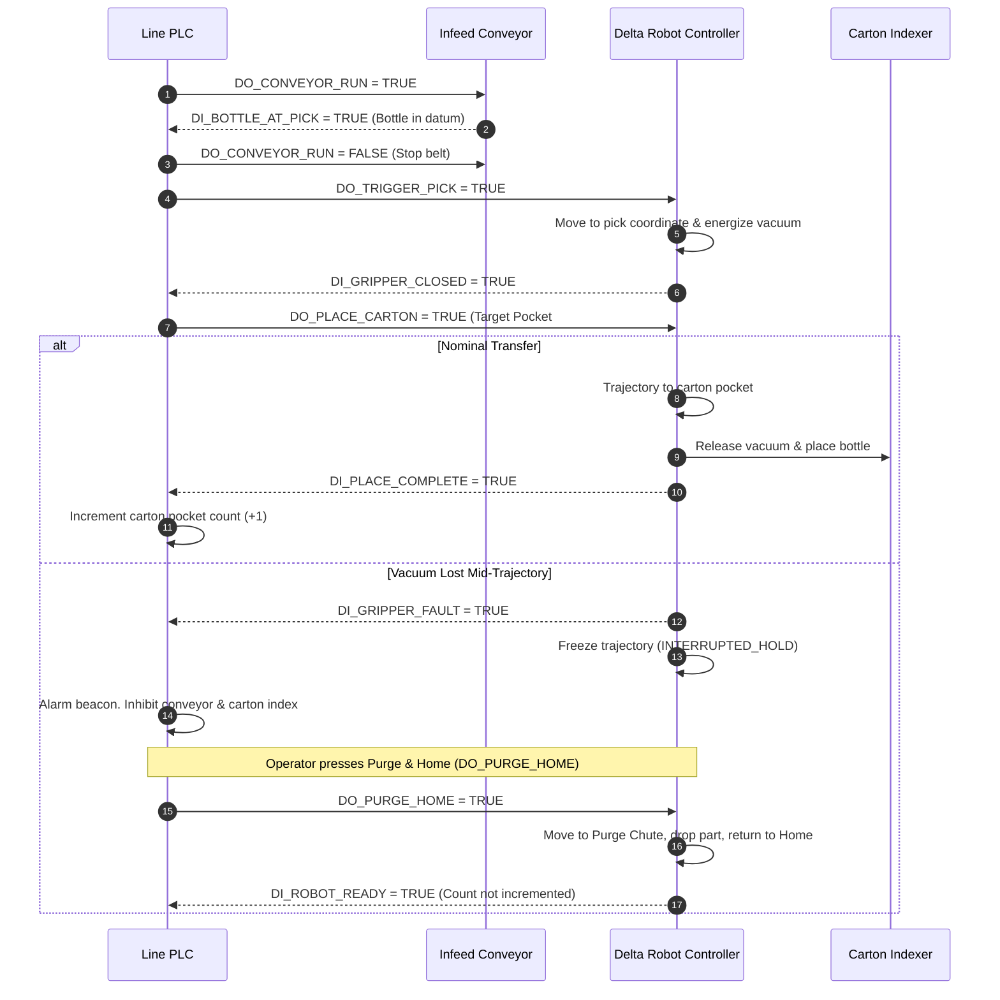

# Robotic Packing Cell — Handshake & Recovery Specifications

## 1. PLC ↔ Robot Controller Discrete I/O Handshake

| Tag Name | Direction | Signal Type | Description |
|---|---|---|---|
| `DI_ROBOT_READY` | Input from Robot | `%I5.0` | Robot controller in automatic cycle & drives enabled |
| `DO_CONVEYOR_RUN` | Output to Infeed | `%Q5.0` | Index infeed conveyor to feed next bottle |
| `DI_BOTTLE_AT_PICK`| Input from Sensor | `%I5.1` | Optical proximity sensor detects bottle at pick datum |
| `DO_TRIGGER_PICK` | Output to Robot | `%Q5.1` | PLC signals robot to descend and grip bottle |
| `DI_GRIPPER_CLOSED`| Input from Robot | `%I5.2` | Vacuum switch / mechanical jaw confirmed gripped |
| `DO_PLACE_CARTON` | Output to Robot | `%Q5.2` | PLC coordinates arm move to carton target pocket |
| `DI_PLACE_COMPLETE`| Input from Robot | `%I5.3` | Bottle deposited into carton; arm retracted |
| `DI_GRIPPER_FAULT` | Input from Robot | `%I5.4` | Vacuum lost mid-trajectory / gripper collision |
| `DO_PURGE_HOME` | Output to Robot | `%Q5.4` | Command arm to drop part in reject chute & return home |

---

## 2. Handshake Sequence Diagram

---

## 3. Carton Packing Matrix

- **50g Format:** 12 bottles (3 rows x 4 columns). Upon pocket 12 completion:
  `DO_CARTON_DISCHARGE` pulses; carton conveyor indexes fresh empty carton.
- **100g Format:** 6 bottles (2 rows x 3 columns). Upon pocket 6 completion:
  `DO_CARTON_DISCHARGE` pulses; carton conveyor indexes fresh empty carton.
